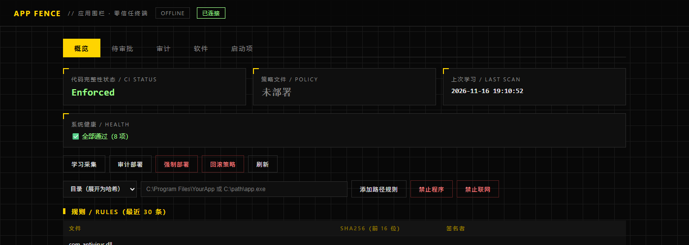

# AppFence（应用围栏）

> 把 ThreatLocker 的零信任思路，轻量化做成**个人也能用**的 Windows 应用白名单终端。



---

## 先说人话：它解决什么问题？

**传统杀毒软件是「认坏人」**：靠病毒特征库，新病毒（没特征）跑得通。

**AppFence 是「默认拒绝」**：没被批准的程序**一律不能跑**——不管它是不是病毒。
这就是 **ThreatLocker**（企业级零信任产品）的核心思路。

**但 ThreatLocker 要企业订阅、云端控制台、内核驱动、专业运维。**
**AppFence 把它轻量化**：一个安装包、浏览器控制台、完全离线、免费。

---

## 界面风格

**终末地（Arknights: Endfield）风格**：

- 黑底 + 亮黄强调色（选中项黄底黑字）
- 细线网格底纹、无圆角、左上角标
- 等宽字体展示状态/哈希/时间
- 终端式日志（`> SYSTEM LOG //`）
- 快速闪动 / 激进缓动（easeOutExpo）的进入动效


---

## 功能一览

### 应用白名单（核心）

| 能力 | 说明 |
|---|---|
| **学习采集** | 读取 CodeIntegrity 事件，自动学习常用程序 |
| **规则类型** | 哈希（SHA1/SHA256）、路径、目录、签名者、拒绝（Deny） |
| **审计模式** | 只记录不拦截，安全观察 |
| **强制模式** | 真正拦截（含部署前覆盖率检查 + 看门狗自动回滚） |
| **多策略签名** | 自签名证书 + PKCS#7（签名者规则在新格式下可用） |

### 审批流

- **待审批列表**：被拦程序 → 一键允许
- **用户申请工具**（`WdacRequest.exe`）：普通用户提交申请 → 管理员批准
- **提权申请**：记录 + 审批（无驱动限制下，透明提权不可行，诚实说明）

### 网络围栏

- 按程序 **禁止联网**（全部 / 指定目标 IP/网段）
- 适合：阻止未知程序外连、限制 AI 工具访问敏感网络

### 启动项管理（Autoruns 式）

- 扫描 4 类来源：注册表 Run/RunOnce（所有用户）、启动文件夹、登录计划任务、Winlogon
- **变化监视**（60 秒）：新增/移除记入历史
- **未知发布者告警**：未签名/验签失败的程序高亮
- **增删管理**：操作前自动快照，可恢复

### 应用管理（Geek Uninstaller 式）

- 扫描已安装应用（注册表 Uninstall）
- 卸载（自动备份注册表键，可选彻底删除残留目录）
- 按发布者筛选 + 批量信任/拒绝

### 观测与安全

- 审计日志 + 关键事件（3076/3077/3033/3089）
- 报告导出（CSV / HTML）
- 健康检查（8 项）
- 托盘告警（启动项变化气泡通知）

---

## 零信任思维方式

| 原则 | 本项目的对应 |
|---|---|
| **默认拒绝** | 未批准程序不运行 |
| **最小权限** | 按程序控制网络/启动 |
| **审批** | 用户申请 → 管理员批准 |
| **审计** | 全量事件记录 + 报告 |
| **可回滚** | 快照 + 看门狗自动恢复 |

---

## AI 场景（重点）

ThreatLocker 的零信任思路，在 AI 时代反而更有价值：

### 1. AI Agent 工具调用白名单

AI Agent 能执行命令/运行程序，**如果被提示注入或跑偏，可能执行任意程序**。
用 AppFence 给 AI 的「工具执行层」加白名单：**AI 只能运行你批准的程序**。

### 2. 本地 AI 工具链围栏

Ollama / LM Studio / ComfyUI / n8n 等本地工具：
- **网络围栏**：限制其只能访问指定目标（防止数据/模型被外传）
- **进程白名单**：防止工具目录被替换成恶意程序（哈希校验）

### 3. AI 生成程序的运行审批

AI 生成的 exe/脚本，运行前进入**待审批**，由人确认后再放行。

### 4. 自动化工作流隔离

AI 自动化（n8n、脚本、RPA）按程序限制网络/启动，减少"自动化失控"风险。

### 5. 本地模型与数据保护

限制可访问模型目录的程序范围（哈希白名单 + 启动项监视），防止模型/数据被未授权程序读取。

> 一句话：**AI 越能干，越需要"它能动什么"的边界**——这正是零信任要解决的问题。

---

## 其他适用场景

- 个人电脑：防流氓软件、防未授权程序、控制启动项
- 家庭 / 小团队：离线内网的单机白名单
- 学习 Windows App Control（WDAC / Code Integrity）
- 老旧电脑：轻量（无驱动、无云、单 exe）

---

## 借鉴的项目与思路

本项目的**功能与思维方式**借鉴了以下项目：

| 项目 | 借鉴内容 |
|---|---|
| **ThreatLocker** | 零信任/默认拒绝/Ringfencing 围栏/Cyber Hero 审批流程 |
| **Microsoft WDAC / App Control** | 底层策略引擎（Code Integrity / SIPolicy） |
| **AppLocker** | 应用白名单概念（哈希/路径/发布者） |
| **Sysinternals Autoruns** | 启动项扫描与管理的分类方式 |
| **Geek Uninstaller** | 应用扫描/卸载/残留清理 |
| **AppControl Manager** | 多策略格式与签名工具链思路 |
| **Sysinternals Sigcheck** | 签名验证（未知发布者判定） |
| **Windows 防火墙** | 按程序/目标的网络控制 |

> 说明：AppFence 是独立实现，代码不包含上述项目的源码；仅借鉴设计思路与交互方式。

---

## 快速开始

### 安装

1. 下载/获取 `AppFence-Setup.exe`（管理员运行）
2. 安装完成自动打开控制台：`http://localhost:8765`
3. 静默安装：`AppFence-Setup.exe /S`
4. 卸载：`AppFence-Setup.exe /U`

### 使用（3 步）

1. **学习采集**：控制台 →「学习采集」（1–5 分钟）
2. **审计部署** → 重启（只记录，安全）
3. 观察后 → **强制部署**（真正拦截）

### 安全建议

- 先审计模式观察 1–2 天再切强制
- 强制部署前确保快照/还原点
- 异常时：控制台「回滚策略」或 `/U` 卸载

---

## 系统要求与局限（诚实）

| 项目 | 说明 |
|---|---|
| 系统 | Windows 10/11 **企业版/教育版/Server**（家庭版不能部署完整 WDAC） |
| 权限 | 安装/部署需管理员 |
| 网络 | 完全离线可用 |
| **无内核驱动** | 围栏为**用户态**（防火墙），可被提权绕过；存储/注册表/进程围栏未实现 |
| **无透明提权** | 提权控制仅为审批层，UAC 仍需用户操作 |
| **单机** | 无多终端集中管理（规划中） |

---

## 目录结构

```
agent/      Agent 源码（服务/托盘/申请工具）
console/    控制台 UI（终末地风格）
scripts/    策略/审批/启动项/卸载/签名等
installer/  安装器源码与图标
docs/       设计/对比/测试文档
```

---

## License

[MIT](LICENSE)

---

> **AppFence** —— 让零信任从企业机房，走进你的桌面。
